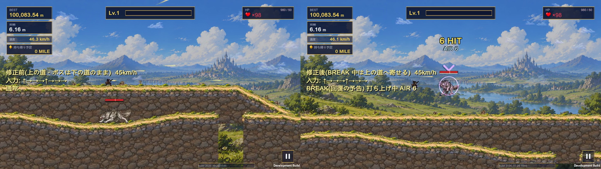
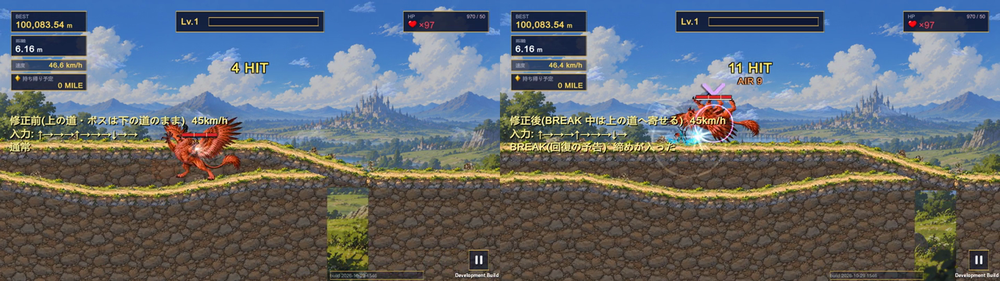

# BREAK 中に攻撃が出なくなる件 / リヴァイアサンが BREAK 中に外れる件(2026-10-29 夜、マスターの依頼)

確認は Windows の試験版「One More Mile Test」(本物の保存は前後で変わらないことを毎回確認)。実機は APK 397 を基準にマスターが確認。

## 1. BREAK 中に攻撃が出なくなる件 — 原因確定: ゲーム側(荒野街道の上下ルートの分岐)。修正済み

### 結論
- **原因**: 荒野街道はボス戦中も上下ルートの分岐が出る。プレイヤーがジャンプの後に**上の道へ着地**すると、ボスは**下の道に立ったまま**なので、
  高さの差が 4〜6m(最大 9m)に開く。入力は受け付けられ技も出るが、**弾も近接もボスの体の上を通って当たらない**(分類は「技は出たが当たっていない」)。
  打ち上げたボスも寄せの高さに付いて来られず落ち、BREAK が終わるまで当たらないまま。
- **修正**: BREAK の間だけ、プレイヤーが上の道にいる時はボスの立つ高さを上の道の高さへなめらかに寄せる(上がる 14m/秒・戻る 10m/秒、瞬間移動しない)。
  BREAK が終われば下の道へ戻る。横の寄せと同じ「BREAK はご褒美の時間」の扱い。攻撃速度・BREAK の時間・威力は変えていない。
  (`WildBossBase.TerrainGround` → `BreakRouteLift`。荒野街道=分岐のあるステージだけで働く。自然洞窟は一本道、天空回廊は分岐なしなので変わらない)
- **サソリ(自然洞窟)**: 一本道のステージなので、この原因には当たらない。今回の記録(指の経路・直接の入力の両方)でもサソリは入力の取りこぼし・止まりは無かった。
  実機で起きた時の状況が分かれば、同じ記録で取り直す(下の「残件」)。

### 修正前と修正後(試験版・二丁拳銃・オオカミ/グリフォン 45/150km/h・各4回・上下ルートあり、同じビルドで切り替え)
| | 修正前(`-baNoRouteLift 1`) | 修正後 |
|---|---|---|
| 上の道に立っている時、ボスの体の下端との高さの差が 2.5m を超えたフレーム | 115 | **0** |
| 上の道に立っている時の高さの差の最大 | 5.82m | **2.29m** |
| 途中から当たらなくなった回 | オオカミ 45km/h の4回目(13回中3回だけ当たった。1.6秒に上の道へ着地 → 以降の入力は全部受け付け・弾も出たが、体の 4.4〜6.8m 上を通った) | なし |
| 一番近づいた後の外れ(下の道でも同じように出る、打ち上げで離れた所の → と地上の ↓) | 10 + 11 | 12 + 12 |

止まった回の時間軸(修正前・オオカミ 45km/h #3、抜粋): 0.72秒 ↑ 受け付け → 打ち上げ・当たり2回 → 1.05/1.37秒 → 当たり → **1.62秒 上の道へ着地** → 2.00秒 ↑ 受け付け(弾は体の上 4.45m)
→ 2.32/2.63/2.95秒 → 受け付け(弾は体の上 5.5〜6.8m)→ 3.27秒 ↓(地上・予約)→ 3.40秒 BREAK 終わり。時間の停止・カード選択・画面の板・被弾は無し。

### 比較動画(同じ手順・同じ地点・45km/h、左 = 修正前 / 右 = 修正後、各 6.6秒)
上の道の区間でプレイヤーを上の道に置いてから BREAK させ、↑→→→↑→→→↓→→→↓ を入れた(`-qaBossAirVideo -bvRoute 1`)。
| 動画 | 修正前 | 修正後 |
|---|---|---|
| `break_upper_route_gunslinger_wolf.mp4`(二丁拳銃 × オオカミ) | 当たり 0(弾はボスの上を抜け、BREAK はそのまま終わる) | 打ち上げ → 空中の追撃 → 締め、当たり 8 |
| `break_upper_route_swordsman_griffin.mp4`(剣士 × グリフォン) | 当たり 6、打ち上げなし | 打ち上げ → 締めまで、当たり 13 |




### 回帰の確認(修正後のビルド、試験版、上下ルートあり)
| 試験 | 結果 |
|---|---|
| 二丁拳銃 × 全16ボス × 45/150km/h(BREAK の打ち上げ・寄せ・跳び・めり込み・天井・撃破・報酬1回・攻撃できるまでの時間) | 32/32 合格(上の道へ寄せた回 7) |
| 剣士 × 全16ボス × 45/150km/h | 32/32 合格 |
| 剣士 × オオカミ/グリフォン × 45/150km/h × 3回(上下ルートあり) | 合格。上の道に立っている時の高さの差の最大 1.86m、当たり 13回中 10〜13 |
| 縦画面(486×1080)二丁拳銃 × オオカミ/グリフォン/リヴァイアサン × 2回 | 合格 |
| 古代地底悪魔・フェニックス × 二丁拳銃/剣士 × 45/150km/h | 合格 |
| 本物の保存(試験の前後) | 変わらず |

- 全ボス回帰で前に出ていた「古代地底悪魔は攻撃できる状態にならない」は**試験の測り方の誤り**(当たり判定の幅 2.1m = 画面の 4% で、「画面の 5% 以上見えている」を満たせなかった。実際は見えていて当たっている)。条件を「画面の 5% か体の 6 割」に直した。
- フェニックス 150km/h で1回だけ「攻撃できるまで 0.8秒」があった(前のビルド)。記録を付けて取り直した 6回は全部 0.13秒で、再現しなかった(BREAK の始まりに体が画面の外寄りにあった回とみられるが、その回の記録が無く未確定)。
- 協力プレイ: 寄せは HOST が決めた位置が JOIN へ届く作り(JOIN 側の追加の処理なし)。今回は2台での確認はしていない。

### 調べ方
- BREAK の間を毎フレーム同じ時間軸で書き出す記録を足した(BossAir の中: `-baTrace 1`、単独: `-qaBreakTrace`)。
  記録する物: 指の状態(置く/動かす/離す)・入力の行方(受け付け/予約/後で出た/まとめた/無視)・技の始まり・攻撃中・待ち時間・入力を受けられない状態・被弾の反応・時間の停止とその理由・画面の板・カード選択・BREAK の経過と残り・ボスとの距離・寄せの最中か・ボスの状態・当たり。
- 入力は画面の指と同じ経路(指を置く → 動かす → 離す)でも、従来の直接の入力でも試した。
- 1つの入力ごとに「受け取っていない / 受け取ったが技が出ない / 技は出たが当たっていない / 当たった」に分けた。

### 別に見つかった止まり方: 試験の待ち方(ゲームは正常)— 二丁拳銃 × グリフォン 45km/h
| | 正常な回 | 止まった回 |
|---|---|---|
| BREAK の始まりのボスとの距離(体の手前の端) | 0.00m(届く所) | **1.48m**(浮いて予備動作のまま止まっている) |
| ゲームの寄せ | 不要 | **しない**(寄せ始めるのは 1.5m より遠い時。1.05〜1.5m は寄せない帯) |
| 試験が最初の入力を入れるまで | 0.13秒 | **2.15秒**(試験は 1.25m まで寄るのを最大2秒待っていた) |
| ↑ | 受け付け → 技 → 当たり → **打ち上げ**(BREAK が 4.8秒へ延びる) | 受け付け → 技 → **当たり2回** → 打ち上げ**なし**(残り 0.73秒 = 締めの合図の後) |
| その後 | 13回の入力 | → 2回(待ち時間で予約 → 後で出て当たり)、BREAK は基本の 3.00秒で終わり |

- 指の経路で入れた 626回の入力(オオカミ・グリフォン・サソリ・リヴァイアサン、二丁拳銃と剣士、縦横): **受け取っていない 0** / 受け取ったが技が出ない 15(すべて地上の ↓ = 仕様で技が無い)/ 技は出たが当たらない 75(届かない所・空振り)/ 当たった 536。BossAir の手順(直接の入力・指の経路)でも受け取っていない入力は無し。時間の停止は当たった瞬間のヒットストップだけで、カード選択や画面の板による停止・被弾の反応は無し。
- この回の止まって見えた理由は「試験が2秒待った」+「↑が締めの合図(BREAK の残り 0.8秒)の後に届いた」。締めの合図の後は打ち上げ直さない作り(その間も寄せは続き、→ の追撃と ↓ の締めは届く)なので、BREAK が延びずに終わり、試験は入力を2〜3回しか入れられなかった。

### 正常な硬直など(仕様どおり、変えていない)
| 何が | 時間 | 理由 |
|---|---|---|
| 締めの合図の後は打ち上げない | BREAK の最後の 0.8秒 | 合図を見て ↓ の締めを狙えるように、終わりの時刻を動かさない |
| 二丁拳銃の → が「予約 → 後で出た」 | 撃つ間隔 0.30秒 | 前の弾の待ち時間の間の入力は予約して、空いたら出す |
| 当たった瞬間の停止 | 0.03〜0.05秒 | ヒットストップ(当たりの手応え) |
| 地上の ↓ が「無視」 | — | 地上では ↓ の技は無い(空中なら急降下) |
| BREAK の寄せ | 1.5m より遠い時だけ、0.9m の所まで | 届く所にいるボスは動かさない |

### 修正(試験側)
- 上下ルートの分岐を残す/消すを選べるようにした(`-baKeepRoute 1` で残す。既定は消す = ボスの試験を地形でぶれさせない)。
- BossAir の待ち方を、ゲームの寄せの決まりにそろえた(寄せている間 / 寄せ始める距離より遠い間だけ待つ)。`-baLegacyWait 1` で前の待ち方。
- 前の待ち方と新しい待ち方を同じビルドで比べた(二丁拳銃 × オオカミ/グリフォン/サソリ 45km/h 各6回): どちらも止まりは出なかった
  (前の待ち方で止まる回はまれで、浮いて予備動作のまま 1.25〜1.5m に止まったボスだけ)。
- 新しい待ち方の側で出た「BREAK 中の撃破の確認」の失敗2件(オオカミ)は、上の道に乗ってボスの 3〜9m 上にいたため(上の 1. の原因と同じ)。
  これがきっかけで、上下ルートが本当の原因だと分かった。

ゲームの側は変えていない(攻撃速度・BREAK の時間・威力も変えていない)。

## 2. リヴァイアサンが BREAK 中に外れる件 — 確認済み(攻撃できる状態は保たれている)
- 二丁拳銃 × リヴァイアサン 45/150km/h 各4回、横(1280×720)と縦(486×1080)、指の経路の入力: **全部合格**。
- 「攻撃できる状態」= 当たり判定が画面に見えていて(画面の 5% 以上、細いボスは体の 6 割以上)、プレイヤーより前にある、で毎フレーム測った。
  | | 横 | 縦 |
  |---|---|---|
  | 攻撃できるまで | 0.13〜0.52秒 | 0.13〜0.50秒 |
  | その後に外れたフレーム | 0 | 0 |
  | 当たり(13回中) | 5〜11 | 7〜11 |
  | BREAK 中の撃破・締め | 8/8 | 8/8 |
- 0.4〜0.5秒かかるのは BREAK の始まりにボスが後ろ(体の一部が画面の左)にいた回。寄せで前へ来るまでの時間(仕様の寄せの速さ、変えていない)。
- 寄せの基準の位置(体の手前の端)・当たり判定・カメラの範囲は一致していた(寄せた後の体の手前の端 0.9〜1.3m、画面の中 0.31〜0.59)。
  大きな体の絵は画面の外へはみ出すことがあるが、当たり判定(攻撃できる所)は画面の中に残る。

## 今回の確認結果として記録する項目(APK 397 まで)
| 項目 | 状態 |
|---|---|
| 翻訳(動的な文の型・継承の用語 29言語) | 確認済み |
| 右から左の折り返し(アラビア語・ペルシャ語) | 確認済み(縦横) |
| 言語の切り替え(合成カードの詳細・再起動) | 確認済み |
| 洞窟の天井へのめり込み | 確認済み(0.17m → 0) |
| BREAK 中のボスの前滑り | 確認済み |
| LAN の部屋の画面(作成後・参加後・退出時、縦横) | 確認済み |
| **ONLINE の部屋の画面** | **未確認**(LAN の確認とは別。実際の Relay への接続はしていない) |

### 動的な翻訳の「元の文の部品が残る」表示について
- 訳の無い部品を元の文のまま出すのは、**欠けを防ぐための代わりの表示**で、訳が出来ていることとは別に扱う。
- 開発版では、代わりに出した物を端末に残すようにした: `loc_untranslated.tsv`(言語・種類・元の文・出た文。種類は「訳が無い」「一部だけ訳した(代わりの表示)」「この言語の訳が無く英語」)。保存場所は下の escape_trace.txt と同じ。
- まとめる道具: `Tools/loc/untranslated_report.py <取り出したファイル…>` で、元の文ごとに出た言語・種類・表に型があるかの一覧(訳を足す時の一覧)。
- 確認: 開発版で日本語・英語・アラビア語の画面を一通り回した結果、代わりの表示は **1件**:
  日本語で「ELITE GOBLIN」(日本語の表にこの行が無く英語の表から出た。日本語でも敵の名前は英語のまま出す作り(「GOBLIN」は日本語の表で「GOBLIN」)なので、画面の文字は同じ)。
  実機で残った物は、端末の `loc_untranslated.tsv` を取り出して `untranslated_report.py` で一覧にできる。

## 脱出成功後の FAILED — 未確定のまま(約110回で未再現・原因未確定)
- ログはそのまま維持(ランの ID 付き)。大量の再試験はしていない。
- **escape_trace.txt の保存場所**(開発版の APK): `/sdcard/Android/data/com.zero0084.action2nd/files/escape_trace.txt`(256KB を超えると古い方が `escape_trace.txt.1`)
- **取り出し方**(PC と USB でつなぎ、開発者向けオプションの USB デバッグを ON):
  ```
  adb pull /sdcard/Android/data/com.zero0084.action2nd/files/escape_trace.txt
  adb pull /sdcard/Android/data/com.zero0084.action2nd/files/escape_trace.txt.1
  ```
  (同じ場所に `loc_untranslated.tsv` も。端末の「ファイル」アプリからは Android 11 以降は見えないことが多いので adb で)

## 残件
- ONLINE の部屋の画面: 未確認。
- 脱出成功後の FAILED: 未確定(ログ維持)。
- リヴァイアサンが BREAK の始まりに後ろにいる時、寄せで前へ来るまでの約0.4秒は攻撃できない(仕様の寄せの速さ。今回は変えていない)。
- 実機での確認をお願いしたい所: 荒野街道のボス戦で BREAK 中に上の道へ乗った時、ボスが上の道の高さへ寄ってきて攻撃が当たるか(オオカミ・グリフォン・サイクロプス等)。
- サソリ(自然洞窟)で止まった時は、状況(上下の位置・距離・BREAK の残り)が分かれば同じ記録で取り直す。今回の記録では止まりは出ていない。
- フェニックス 150km/h の「攻撃できるまで 0.8秒」1回: 再現せず未確定。
- 協力プレイでの上の道への寄せ: 2台での確認はまだ。
