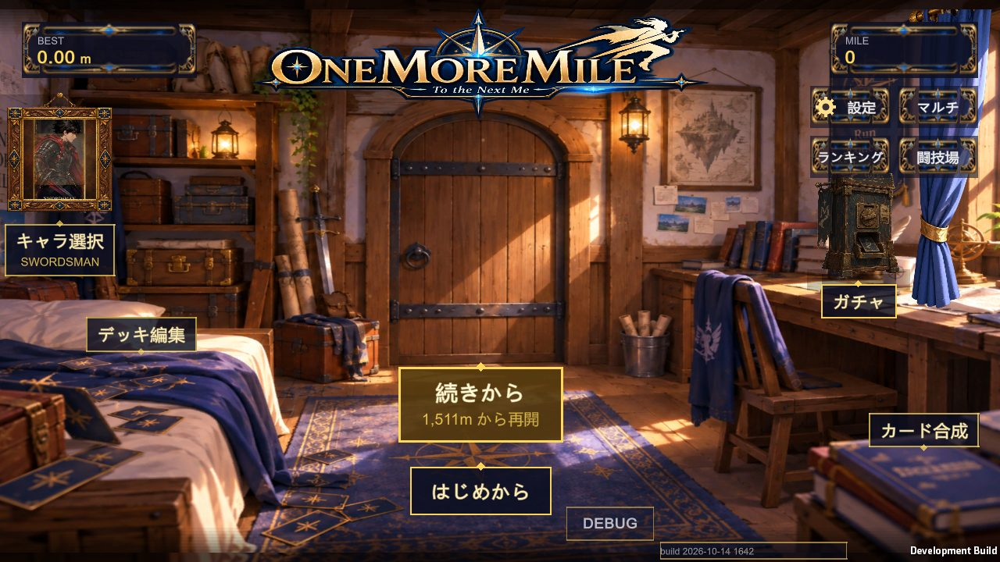
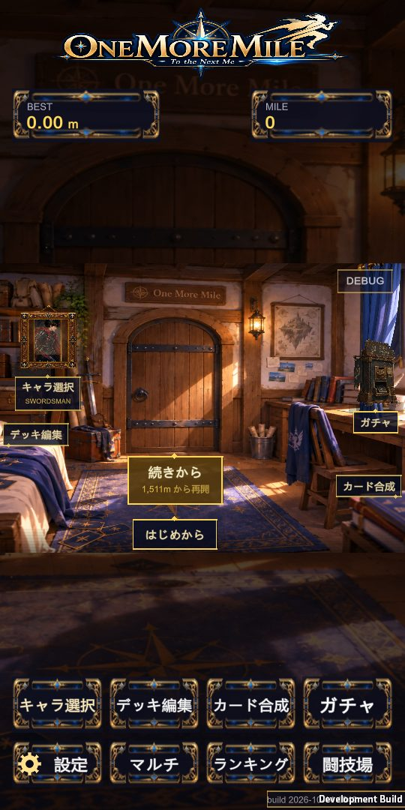
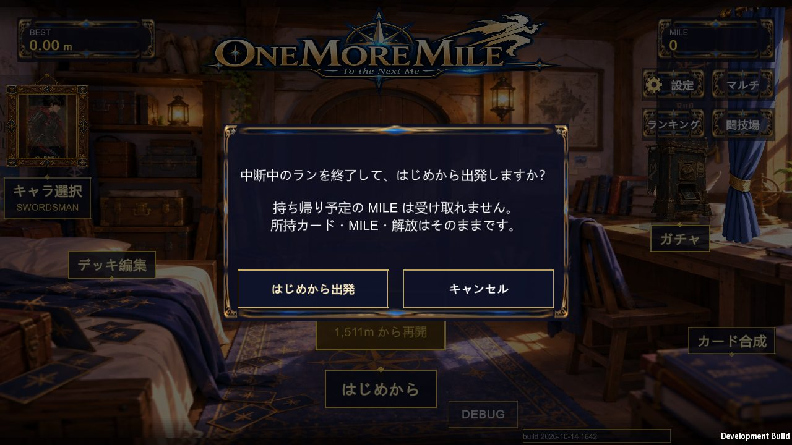
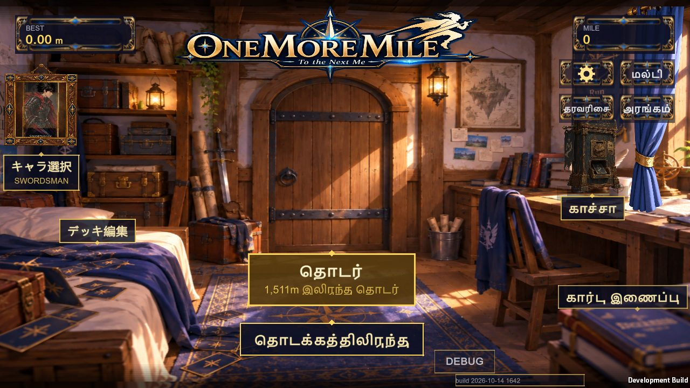
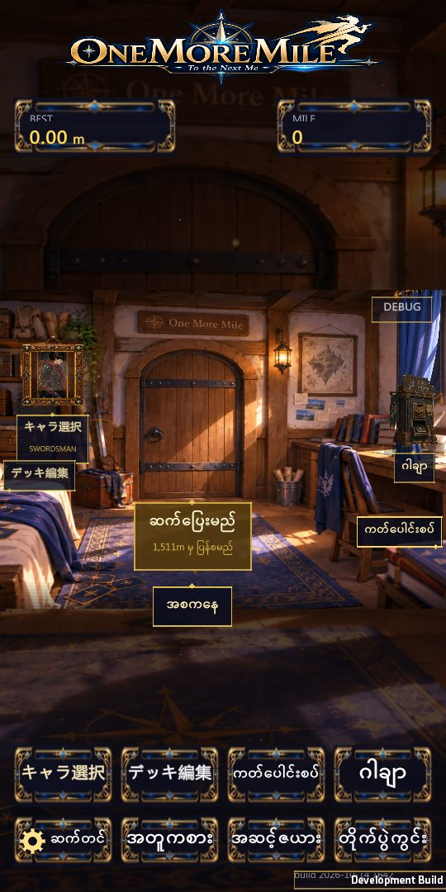
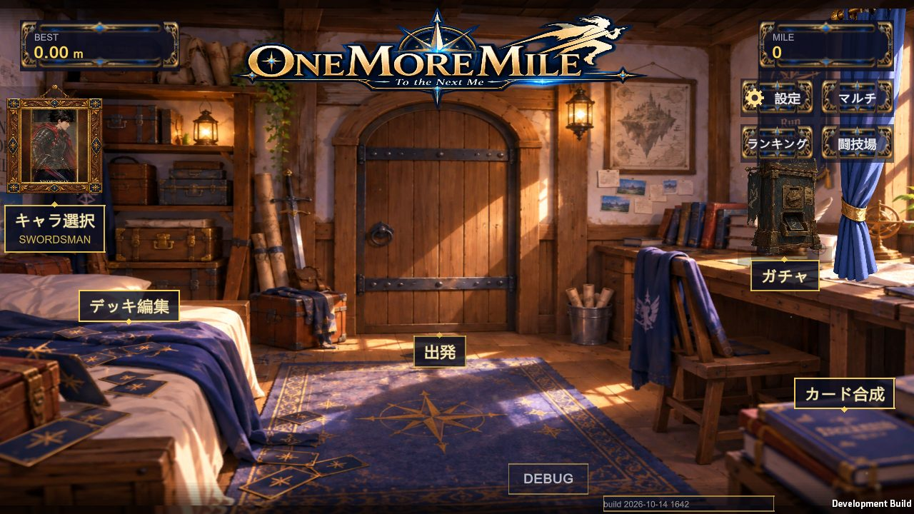
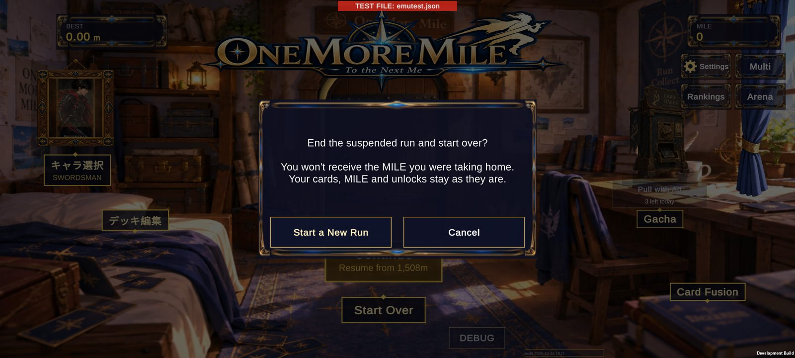

# CONTINUE の再開位置(穴)の原因と、ホームの「続きから」「はじめから」— 2026-10-14(APK 310)

## 1. CONTINUE で穴の上から再開する(4回中2回の失敗)の原因

### 原因
- `TerrainManager.GetHeightAt` は、一番手前のチャンクより**前**の位置を聞かれると、**一番先のチャンクの終わりの高さ**を返していました。
- CONTINUE やワープの直後は、地形がプレイヤーの位置から作られます。そのすぐ手前(例: 再開地点の 4〜10m 手前)は、まだチャンクがありません。
  - そこを聞かれると、先の地形の高さ(例 3.0 や −1.5)が返っていました。
  - そのため「再開地点の直前に段差がある」「足場が無い」と誤って判断されていました。
- 再開の検査(と、それを使う足場の判定)がこの値で失敗していました。失敗するかどうかは、その時に作られた地形の高さの並びによります。これが「4回中2回」の正体です。

### 直し方
- 一番手前のチャンクより前の高さは、**最初の地面の高さ**にしました(穴の部分は飛ばす。`GetSupportHeightAt` と同じ考え方)。
- **保存の距離・統計・報酬は変えていません。位置の補正もしていません**(変えたのは高さの問い合わせだけ)。

### 再開の順番(実際の CONTINUE の処理)
1. 保存した距離へプレイヤーを移す
2. 速度を戻す
3. 再開の安全区間を平らにする予約(`SetResumeFlatZone`)
4. 地形を作る(`GenerateNow`)
5. 地面に立たせる
6. CPU の仲間を戻す
7. 準備の画面(Settling)→ GO

確認の結果、操作できるようになるのは「地形ができて、足場に立った後」でした。順番そのものは正しかったので、変えていません。

### 確認の結果(Windows の開発版、専用の保存ファイル、`-qaResume`)
| 試験 | 結果 |
|---|---|
| 固定の条件: 既にある穴の上の地点(8,000m 付近)から再開、25回 | 合格 25/25(以前は約半分が失敗)。毎回「ワープ直後の手前の高さ = 最初の地面の高さ」 |
| 4マップ(荒野・洞窟・天空・ラスダン)× 通常速度/高速 + 荒野 8km ×4 + 超高速 | 合格。準備の画面の最初の時点で、次のとおり: ・地形は安全区間(15〜69m)より先(+68〜+165m)まで作られている ・キャラの足が地面の高さと一致し、接地している ・GO までの移動 0.00m |
| 再開の全試験(古い中断データ・足場・穴) | 合格(failures=0)。2回通して同じ |

## 2. ホームの「続きから」「はじめから」

- 中断中のランがある時は、扉の下に2枚の札を出します。
  - **続きから**(金色。大きい。下に「1,511m から再開」)
  - **はじめから**
- 以前の扉の上の「CONTINUE」の文字と、小さな「NEW RUN」は無くしました。
- **続きから**の札を押しても、**扉を押しても**、同じ再開の処理が動きます。
- **はじめから** → 確認「中断中のランを終了して、はじめから出発しますか？」
  - 下に「持ち帰り予定の MILE は受け取れません。」「所持カード・MILE・解放はそのままです。」
  - 「はじめから出発」: 中断データだけを終えて、マップ選択へ。カード・MILE・解放は初期化しません。
  - 「キャンセル」: 中断データはそのまま。
- 中断データが無い時は、今までどおり「出発」だけです。
- 札の大きさ:
  - 通常の札の約1.3倍(続きから)と約1.15倍(はじめから)。高さと文字の周りの余白を広げました。
  - 押せる範囲は、見た目より上下左右に少し広くしています。
  - 2枚の間はすき間を空けています(押し間違えの防止)。
- 長い言語で札が横に広がっても、開発版の DEBUG ボタンに重ならないよう、DEBUG ボタンを横へずらします。
- 文言は30言語に訳しました(`Tools/loc/keys_extra16.tsv`、id 9992〜9998)。

### 確認の結果
- **Windows**(`-qaHomeChoice`、専用の保存ファイル)。横 1280×720 と縦 540×1170 で、次の14言語:
  - ja / en / de / ru / ta / my / km / fil / ms / bn / ar / fa / ko / zh-Hans
  - どの言語でも合格(failures=0):
    - 2枚とも出る
    - 押せる範囲が重ならない、すき間がある
    - 画面の中に収まる
    - 他の札や DEBUG ボタンに重ならない
    - 通常の札より大きい
    - 確認の画面のボタンが画面の中にあり、高さ 60px 以上
  - 中断データが無い時は「出発」だけ。
- **Android エミュレーター**(APK 310、専用の試験ファイル)。adb で本当に画面を押して確認しました。
  1. はじめから → 確認の画面が開く
  2. キャンセル → ホームに戻る、中断データが残る
  3. はじめから → はじめから出発 → マップ選択が開く。中断データだけが消え、MILE・カード・解放は同じ
  4. 中断中のランを作り直して「続きから」の札 → 保存した地点から再開
  - 全部合格(failures=0)。

## 3. 画像
- 横(日本語): 
- 縦(日本語): 
- 確認の画面: 
- 長い言語(タミル語、横): 
- 縦(ビルマ語): 
- 中断データが無い時: 
- Android エミュレーター(英語、確認の画面): 

## 4. 未確認
- Android 実機での見た目と押しやすさ(エミュレーターと Windows では確認済み)。
- タミル語などは、文字の組み合わせの表示(合字)がもともと不完全です(今回の変更とは関係なく、ゲーム全体の表示の仕組みの制約)。
- 英語の画面でも、ホームの「キャラ選択」「デッキ編集」の札が日本語のままです(以前からの訳の漏れ。今回は直していません)。
