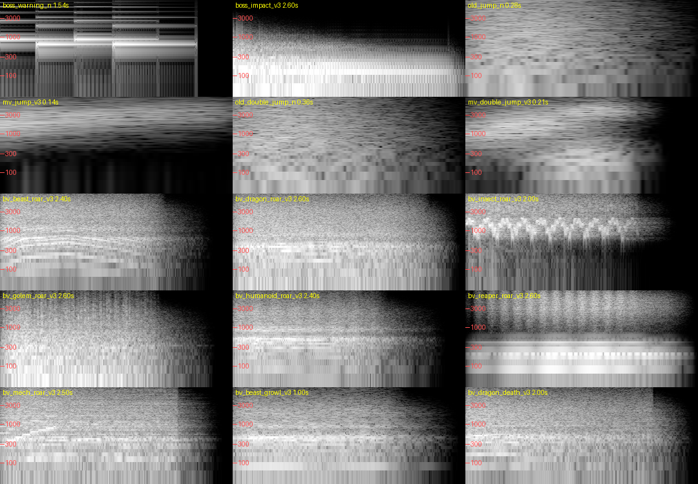

# SE の修正(ボス遭遇・ジャンプ・ボスの声)— 2026-10-14

BGM は変えていません。対象は、ボス遭遇の演出・ジャンプ・ボスの声の3件だけです。

## 1. 変えた SE

| SE(SeId) | 以前のファイル | 新しいファイル | 内容 |
|---|---|---|---|
| ボス遭遇 `BossWarning` | `boss_warning_n.wav`(三角波の 880/660Hz を4回 =「ピンポーン、ピンポーン」) | `boss_impact_v3.wav`(2.6秒) | 重低音の「ドォーン」(下に詳しく) |
| 登場の地鳴り `BossAppear` | `boss_appear_n.wav`(音量 1.0) | 同じファイル、**音量 0.6** | 直後の重低音と重なって濁らないように、小さくした |
| ジャンプ `Jump` | `old_jump_n.wav` | `mv_jump_v3.wav`(0.14秒) | 空気を軽く切る「サッ」 |
| 二段ジャンプ `DoubleJump` | `old_double_jump_n.wav`(625〜833Hz に強い山 =「ホーン」の原因) | `mv_double_jump_v3.wav`(0.21秒) | 少し力強い「シュバッ」 |
| ボスの声(新規)`BossRoar*` / `BossGrowl*` / `BossDeath*` | なし | `bv_<種類>_<場面>_v3.wav` × 21 | 種類7 × 場面3(下) |

**ボス遭遇の「ドォーン」の中身**:
- 低い芯: 58Hz から 34Hz へ沈む音。
- 地鳴り: 低い所のざらつき。
- 頭の「ド」と、短い余韻。
- 高い音程の成分(チャイム感)はありません。

**携帯のスピーカー対策**:
- 携帯のスピーカーは、おおむね 180Hz より下が出ません。
- そのため、低い芯をゆるく歪ませた倍音を 120〜500Hz に足しました。
- 測定値(180Hz より上の大きさ): 以前のチャイム -20dB → 新しい音 -22dB。
- ピークは -5.5dBFS で、音割れはしません。

**ジャンプ**:
- 音程の無い、空気と服のこすれの音です。電子音や楽器の音は使っていません。
- 通常のジャンプは、以前より 1dB 小さくしました。
- 同じ音が同時に鳴る数の上限は、以前どおり 2 です。

## 2. ボスの声

**素材**: 種類ごとに共通です。ボスごとの違いは高さ(Pitch)と音量で出します。表は `Scripts/Audio/BossVoice.cs` にあります。

| 種類 | 音の作り |
|---|---|
| 獣 | うなり・咆哮(ざらついた声帯 + 母音の響き + 息) |
| 竜 | 腹に響く咆哮(低い芯 + 炎の息) |
| 昆虫 | 甲殻のカチカチ・軋み・異質な鳴き声 |
| ゴーレム | 岩がこすれる音 + 金属の軋み |
| 人型 | 低い威圧的な声(「オ/ア」の母音、ゆっくり震える) |
| 死神 | ずれた音程の共鳴 + ささやき |
| 機械 | 段のある駆動音 + 金属的な合成の咆哮 |

**鳴らす場面**(頻繁になりすぎないように):

| 場面 | 鳴らす時 | 制限 |
|---|---|---|
| 咆哮 | 登場して画面に入った時 | ボスごとに1回 |
| うなり | 段階が上がった時 / 必殺技の始まり | 同じボスは 6秒に1回まで |
| 断末魔 | 撃破(BOSS FINISH の始まり。最後の一撃の音の 0.22秒後) | — |

- 天空のボスがもともと鳴らしていた共通の仮の咆哮は、ボスごとの声に置き換えました。入場中は咆哮、攻撃中はうなりです。

**登場の流れ**:
1. 遭遇の重低音「ドォーン」(警告の文字と同時)
2. ボスが出る(登場の地鳴りとボス戦の BGM のフェードイン 0.7秒)
3. ボスが画面に入ったら咆哮
- **重低音から 1.3秒より早くは吠えません**(重なって聞き取りにくくならないように。早い時は少し待ちます)。
- ゲームの進行は止めていません。声は音を足すだけです。

**ボスごとの割り当て**(種類 / 高さ。音量は特記の物だけ):

| マップ | ボス | 種類 | 高さ |
|---|---|---|---|
| 荒野街道 | 巨大オオカミ | 獣 | 1.08 |
| | ゴブリンライダー | 獣 | 1.20(音量 0.85) |
| | 大蛇 | 竜 | 1.30(0.9) |
| | サイクロプス | 人型 | 0.78 |
| | 大蜘蛛 | 昆虫 | 1.00 |
| | ゴーレム | ゴーレム | 1.00 |
| | グリフォン | 獣 | 1.38(0.9) |
| | ヒドラ | 竜 | 1.10 |
| | 魔人(荒野) | 人型 | 0.90 |
| | ドラゴン(80km) | 竜 | 0.96 |
| | 黒騎士 | 人型 | 1.05(0.9) |
| 自然洞窟 | 大百足 | 昆虫 | 1.12 |
| | 大サソリ | 昆虫 | 0.95 |
| | 大モグラ | 獣 | 0.85 |
| | トロール | 人型 | 0.74 |
| | 大ワーム | 昆虫 | 0.68 |
| | 水晶ゴーレム | ゴーレム | 1.15 |
| | 大コウモリ | 獣 | 1.50(0.85) |
| | サソリの王 | 昆虫 | 0.80 |
| | バジリスク | 竜 | 1.20 |
| | 地底竜 | 竜 | 0.92 |
| | 古の魔人 | 人型 | 0.80 |
| 天空回廊 | ドラゴン | 竜 | 0.96 |
| | 魔人 | 人型 | 0.95 |
| | ベヒモス | 獣 | 0.75 |
| | タイタン | 人型 | 0.70 |
| | クラゲ | 死神(共鳴) | 1.30(0.8) |
| | リヴァイアサン | 竜 | 0.80 |
| | フェンリル | 獣 | 0.90 |
| | 天空ゴーレム | ゴーレム | 0.90 |
| | フェニックス | 獣 | 1.45(0.9) |
| | 天空の大蛇 | 竜 | 1.05 |
| | 天空の守護者 | 人型 | 1.15 |
| ラスダン | メカドラゴン | 機械 | 1.00 |
| 100km | 死神(追跡・三姉妹) | 死神 | 1.00 |

## 3. 共通の条件
- **再生の道**:
  - AudioManager の SE と同じ道で鳴らします。SE の音量・消音・同時に鳴る数の上限・優先度に従います。
  - このゲームに AudioMixer はありません。音量は AudioManager が持っています。
  - 消音の時は鳴りません(確認済み)。
- **重ならない**:
  - 同じ声は同時に1つ。
  - 咆哮は 1.5秒、うなりは 1.0秒より短い間隔では重ねません。
  - ボスごとの回数の制限は上の表のとおりです。
- **止める時**: ポーズ / ゲームオーバー / ホームへ戻る時に止めます。撃破の時は、そのボスの咆哮・うなりを止めてから断末魔を鳴らします。
- **マルチ**:
  - 各端末で自分で鳴らします。
  - 登場の咆哮は、JOIN の端末でも入場の時間ぶん後に鳴ります。
  - 断末魔は全員の端末で鳴ります。
  - 段階/必殺技のうなりは、ボスを動かす HOST(とソロ)だけです。
  - CPU の仲間の動きの音は、以前どおり鳴らしません。
- **変えていない物**: 戦闘の判定、ボスの AI、HitStop、FINISH の処理。声と音の割り当てを足しただけです。

## 4. 音源の出典とライセンス
- **すべて自作の合成音**です。`Tools/audio/gen_audio_v3.py` が数式で作った音で、外部の素材・録音・サンプルは使っていません。
- 権利はプロジェクトにあり、商用のゲームで使えます。
- 作り直し: `python Tools/audio/gen_audio_v3.py`(同じ乱数の種で同じ音になります)。
- 大きさの段は `gen_audio_v2.py` と同じ基準です。

## 5. すぐ戻す方法
- 以前のファイルは消していません(`boss_warning_n` / `old_jump_n` / `old_double_jump_n` はそのまま)。
- Unity のメニュー `Tools/OneMoreMile/Audio/Revert SE update 2026-10-14` を実行すると、次のとおり戻ります。
  - ジャンプ・二段・遭遇の音を元のファイルへ
  - 登場の地鳴りの音量を 1.0 へ
  - ボスの声の割り当てを外す(鳴らなくなる)
- 当て直す時は `Apply SE update 2026-10-14` です。
- コードで声だけを止めるには `BossVoice.Enabled = false` です。

## 6. 確認の結果(Windows の開発版、`-qaBossVoice`、専用の保存ファイル)
| 確認 | 結果 |
|---|---|
| 割り当て: ジャンプ/二段/遭遇の音が新しいファイル、登場の地鳴りの音量 0.6、声 21 個すべてに音、全ボスの名前が表にある | 合格 |
| **本当の遭遇**(荒野 1〜5km、5回連続)| 合格。毎回、重低音 0秒 → 登場の地鳴り +0.42秒 → ボス戦の BGM +0.5秒 → 咆哮 +1.5〜6.5秒(ボスが画面に入った時。入場の長さはボスごと) |
| 同上: 1回の遭遇で重低音 1回、咆哮はボスごとに 1回 | 合格 |
| 同上: 撃破で断末魔、その3秒後にボスの声が残っていない | 合格 |
| 同上: 5回続けても SE の声の数が溜まらない(同時の最大 7/20、取りこぼし 0) | 合格 |
| **全ボス 34**(荒野 11 / 洞窟 11 / 天空 12、メカドラゴン含む)を出して、種類どおりの咆哮・断末魔、ボスごとの高さ | 合格 34/34(例: オオカミ 1.06、コウモリ 1.46、ワーム 0.69。フェニックスは仕様で一度蘇るので、2回目に断末魔) |
| 追跡の死神(100,000m): 重低音の後に不気味な声 | 合格 |
| ポーズで声が止まる / ポーズ中は新しく鳴らない / ゲームオーバーで止まる | 合格 |
| 消音: ボスの声もジャンプも鳴らない | 合格 |
| SE の音量 1.0 → 0.5 で、声の音量が 0.50 倍 | 合格 |
| **本当のジャンプの処理**で 通常 → 二段 を 8回続ける | 合格: 通常 8回・二段 8回とも新しい音。同時に鳴ったジャンプの音は最大 1 |
| ジャンプの SE を 12回連打 | 同時に最大 3(上限の範囲)。重なって大きくならない |
| FPS(ボス + 声 あり / なし) | 60 / 60(変化なし) |
| 既存の音の自動試験(`-qaAudio`) | 合格(失敗 0) |
| 既存の主な試験(画面・闘技場・再開・保存・ランキング・引き継ぎ・広告の模擬)+ 通常のセーブが変わらない | 合格 |

- 確認の途中で直した物: ボスの遭遇の演出が、遭遇の音を AudioLibrary を通さずに直接鳴らしていました。そのため、音量の設定(登場の地鳴り 0.6)・優先度・鳴った時刻(声が重低音を待つ判断)が効いていませんでした → AudioLibrary の設定で鳴らすように直しました。
- 波形の確認: `spectrogram.png`(上が以前のチャイム、新しい重低音、ジャンプ、各種類の咆哮)。

## 7. 未確認
- Android 実機での聞こえ方(特に携帯のスピーカーでの重低音の重さ、イヤホンとの違い)。
- 人の耳での聞こえ方の確認は、マスターにお願いします(アイリーンは波形と周波数で確かめています)。
